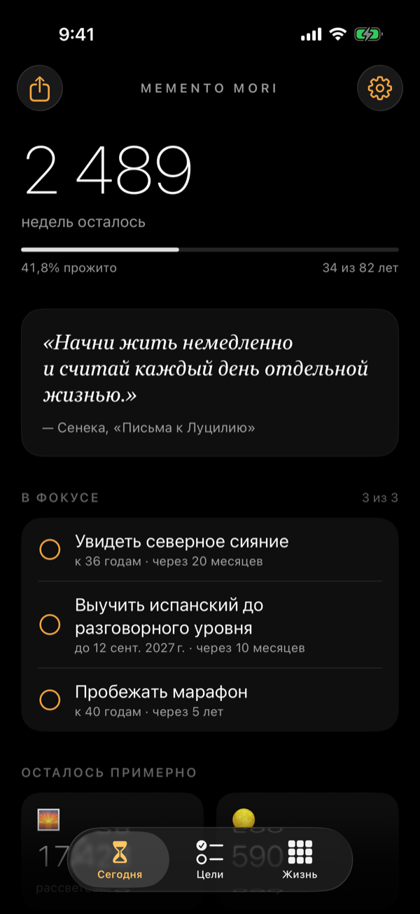
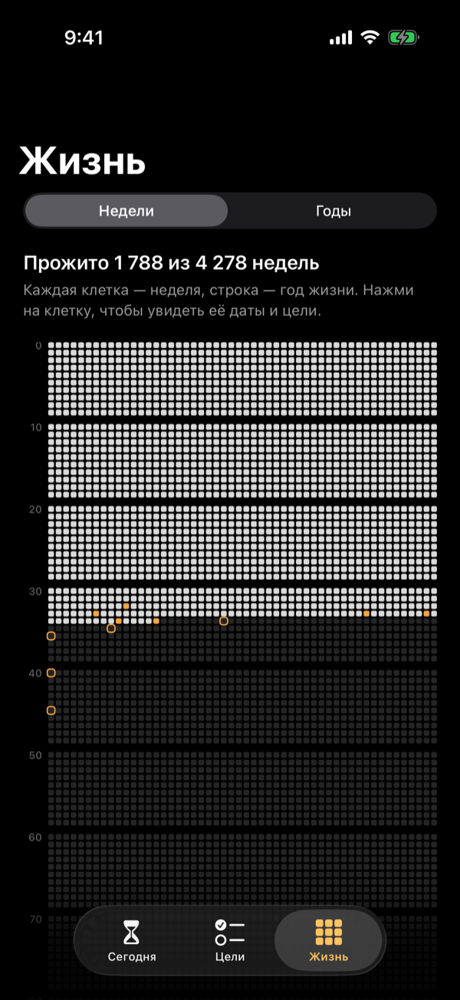
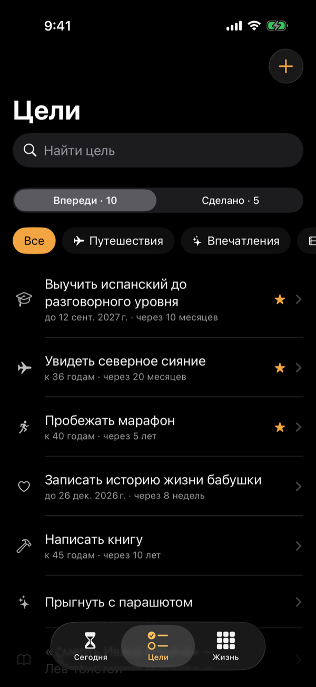
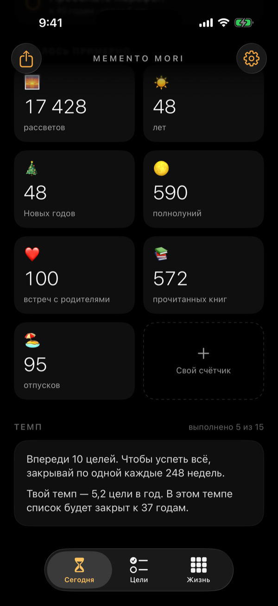
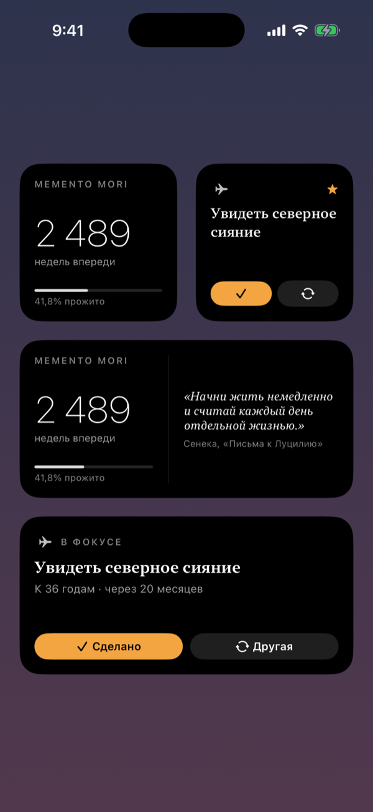
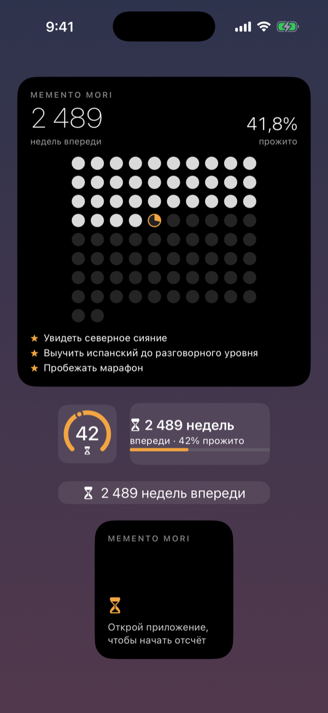

# Memento Mori

**Помни о смерти — живи сейчас.** Приложение для iPhone, где ты собираешь всё, что хочешь успеть в жизни: страны, фильмы, книги, впечатления, навыки. И постоянно видишь, сколько времени у тебя осталось.

Минималистичное (чёрный фон, белый текст, один тёплый акцент), полностью офлайн, без аккаунтов и рекламы. iOS 17+, SwiftUI, виджеты WidgetKit.

<p align="center">
  
  
  
</p>
<p align="center">
  
  
  
</p>

<sub>Скриншоты сняты в симуляторе на демонстрационных данных — см. раздел «Демо-режим и скриншоты».</sub>

---

## Что умеет

**Время**
- **Без гаданий о сроке.** Не обязательно решать, сколько тебе жить: по умолчанию берётся средняя продолжительность жизни в твоей стране (данные Всемирного банка за 2023 год, 207 стран и территорий). Можно выбрать другую страну, «весь мир» или указать своё число.
- **Главный счётчик.** Сколько недель осталось. Нажатие переключает единицы: недели → дни → часы → *живые секунды* → годы → процент прожитого. Недели календарные — с понедельника по воскресенье, счётчик уменьшается в ночь на понедельник.
- **Жизнь в неделях.** Вся жизнь на одном экране: клетка — неделя с понедельника по воскресенье, строка — год. Прожитое закрашено, текущая неделя пульсирует. **На сетку нанесены твои цели**: выполненные — в неделе, когда ты их закрыл, сроки — рамкой в неделе дедлайна. Нажми на клетку, чтобы увидеть её даты и цели. Есть режим «жизнь в годах».
- **«Осталось примерно».** Рассветов, полнолуний, Новых годов — и ударов сердца. И **свои счётчики** в духе эссе Тима Урбана «The Tail End»: «встречаешь родителей 5 раз в год ещё лет 20 — впереди около 100 встреч». Есть готовые идеи: книги, отпуска, встречи с друзьями.

**Цели**
- **Умное создание цели.** Пока печатаешь, приложение подсказывает похожие идеи из библиотеки, само угадывает категорию («Прочитать…» — книги, «Пробежать…» — тело) и замечает страну в тексте («Поехать в Японию» → 🇯🇵). Срок — в один тап: «до конца года», «через год», «к 40 годам», а внизу видно, какая это доля оставшейся жизни.
- **Шаги.** Большую цель можно разбить на шаги («Сделать визу», «Купить билеты») — или попросить приложение предложить типичные. Ближайший шаг виден на главном экране и в виджете: «Дальше: купить билеты».
- **Категории**: путешествия, впечатления, фильмы, книги, навыки, тело, люди, «создать».
- **Сроки по возрасту** («к 35 годам»), а не только по дате. Приложение покажет, сколько недель до срока и какая это доля оставшейся жизни.
- **Фокус**: до трёх главных целей — на главном экране и в виджете.
- **«Зачем?»**: поле для мотивации у каждой цели.
- **Темп.** Приложение считает, как быстро ты закрываешь цели, и говорит прямо: «В этом темпе список будет закрыт к 47 годам» — или «не успеешь, ускорься». Ещё оно показывает нужный темп: «закрывай по одной цели каждые 37 недель».
- **Воспоминания.** Закрывая цель, можно добавить дату, пару слов и фото. Выполненное складывается в хронику по годам.
- **Библиотека идей.** Около 90 идей, чтобы не начинать с чистого листа: от северного сияния до «Смерти Ивана Ильича».

**Мир**
- **Интерактивная карта путешествий.** Отдельная вкладка с картой мира: приближай двумя пальцами, двигай, нажимай на страну. Посещённые страны горят тёплым светом, запланированные — полупрозрачно. В карточке страны — «Посещено» и «В планах» (это сразу цель в списке), часть света и средняя продолжительность жизни там.
- **Статистика**: «12 из 195 стран · 6% мира», прогресс по каждой части света и ближайшая отметка («до 15 стран — ещё 3»).
- **Список стран** с поиском и фильтрами «Посещено / В планах / Все»; нажатие на страну в списке плавно показывает её на карте.
- **Карточка «Мой мир»** для соцсетей — карта и цифры одной картинкой.

**Напоминания и прочее**
- **Ежедневные или еженедельные напоминания** в выбранное время. Каждый день разные: мысль стоиков, цель из твоего списка («Осталось 2 263 недели. „Япония“ всё ещё в списке. Может, начать сегодня?»), прогресс жизни. О сроках целей напомнит за месяц и в сам день.
- **Мысль дня**: 25 цитат о времени — Сенека, Марк Аврелий, Монтень, Булгаков, Стив Джобс.
- **Карточка для соцсетей**: жизнь в годах и главные цифры одной картинкой.
- **Экспорт и импорт** данных в JSON (резервная копия, перенос на другой телефон).

**Виджеты**
- **«Время жизни»** — маленький, средний (с мыслью дня) и большой (жизнь в годах и цели в фокусе). Есть версии для **экрана блокировки**: кольцо с процентом, прямоугольный и строка над часами. Считать можно в годах, месяцах, неделях, днях, часах, минутах или **живыми секундами**, которые тикают прямо на экране: удерживай виджет → **Изменить виджет** → «Считать в».
- **«Цель дня»** — **интерактивный** виджет: одна цель из списка, её следующий шаг и кнопки «✓ Сделано» и «↻ Другая» прямо на главном экране, без открытия приложения.
- **«Мой мир»** — карта посещённых стран; в большом размере ещё и прогресс по частям света.

---

## Что понадобится

| | |
|---|---|
| **Mac** | macOS, на которой запускается актуальный Xcode |
| **Xcode** | 16 или новее, лучше последняя версия. Бесплатно в Mac App Store |
| **iPhone** | iOS 17 или новее, кабель для первого подключения |
| **Apple ID** | Подойдёт обычный бесплатный. Платный Apple Developer Program ($99 в год) нужен только для App Store и TestFlight |

> Без Mac собрать iOS-приложение нельзя: это ограничение Apple. Если Mac нет, можно взять облачный (MacinCloud, AWS EC2 Mac и т. п.).

---

## Как запустить на своём iPhone

### 1. Скачай проект

```bash
git clone https://github.com/artyomvorobiov/memento_mori.git
cd memento_mori
```

Или на странице репозитория нажми **Code → Download ZIP** и распакуй архив.

> Код лежит в ветке `claude/adoring-wright-g072kb` — сейчас она основная в репозитории, поэтому `git clone` и Download ZIP возьмут именно её. При желании её можно переименовать в `main`: **Settings → General → Default branch** на GitHub.

### 2. Задай свой идентификатор приложения

У каждого приложения на iPhone есть уникальный **bundle id**. Шаблонный `com.yourname.mementomori` Apple не даст зарегистрировать, поэтому придумай свой: латиница, цифры, точки и дефисы, например `com.ivanpetrov.mementomori`.

В Терминале, в папке проекта:

```bash
./scripts/set-bundle-id.sh com.ivanpetrov.mementomori
```

Скрипт поменяет идентификатор в трёх местах.

<details>
<summary>Без скрипта, вручную</summary>

1. В `Config.xcconfig` замени значение `BASE_BUNDLE_ID` на свой идентификатор.
2. В `MementoMori/MementoMori.entitlements` и в `MementoWidget/MementoWidget.entitlements` замени `group.com.yourname.mementomori` на `group.<твой идентификатор>`.

Строки должны совпадать, иначе виджет не увидит данные приложения.
</details>

### 3. Открой проект в Xcode и выбери команду разработчика

1. Двойным щелчком открой **`MementoMori.xcodeproj`**.
2. **Xcode → Settings… → Accounts → «+» → Apple ID** — войди своим Apple ID. Появится команда «*Твоё имя* (Personal Team)».
3. Слева в навигаторе выбери синий значок проекта **MementoMori**, затем таргет **MementoMori** → вкладка **Signing & Capabilities**:
   - галочка **Automatically manage signing**;
   - **Team** — твоя команда.
4. То же самое для таргета **MementoWidgetExtension**.
5. Проверь, что в обоих таргетах в блоке **App Groups** стоит галочка напротив `group.<твой идентификатор>`. Если строка красная, нажми ↻ (Try Again) или удали её «−» и добавь заново «+» с тем же именем.

### 4. Запусти на симуляторе — iPhone пока не нужен

Вверху Xcode выбери любой симулятор iPhone и нажми **⌘R** (кнопка ▶). Через минуту откроется приложение.

### 5. Запусти на iPhone

1. Подключи iPhone кабелем, разблокируй и нажми **«Доверять этому компьютеру»**.
2. Включи **режим разработчика**: на iPhone **Настройки → Конфиденциальность и безопасность → Режим разработчика → Вкл.**, перезагрузи телефон и подтверди. Если такого пункта нет, выбери iPhone в Xcode (следующий пункт) и один раз нажми ⌘R — после этого он появится.
3. В Xcode вверху выбери свой iPhone вместо симулятора и нажми **⌘R**.
4. При первом запуске iPhone скажет «Ненадёжный разработчик». Открой **Настройки → Основные → VPN и управление устройством**, выбери свой Apple ID и нажми **«Доверять»**. Снова нажми **⌘R**.

Готово, приложение на телефоне. Дальше можно запускать по Wi-Fi без кабеля: **Window → Devices and Simulators** → галочка **Connect via network**.

### 6. Добавь виджеты

- **Главный экран:** удерживай палец на пустом месте → **Изменить → Добавить виджет** → найди **Memento Mori** → выбери «Время жизни», «Цель дня» или «Мой мир» и размер.
- **Экран блокировки:** удерживай палец на заблокированном экране → **Настроить → Экран блокировки** → нажми на область виджетов → **Memento Mori**.

> Если виджет пишет «Открой приложение…», один раз открой приложение и пройди знакомство. Если надпись не пропадает, App Group настроен неправильно: в настройках приложения появится предупреждение, а решение описано ниже, в разделе «Частые проблемы».

---

## Бесплатный аккаунт и платный: в чём разница

| | Бесплатный Apple ID | Apple Developer Program ($99/год) |
|---|---|---|
| Установка на свой iPhone | ✅ | ✅ |
| Виджеты, уведомления | ✅ | ✅ |
| Срок работы установки | **7 дней**, потом нужно снова нажать ⌘R в Xcode (данные сохранятся) | 1 год |
| Сколько своих приложений на устройстве | до 3 | без ограничений |
| TestFlight (раздать друзьям) | ❌ | ✅ |
| Публикация в App Store | ❌ | ✅ |

Для себя бесплатного аккаунта хватает: раз в неделю подключаешь телефон к Mac и нажимаешь ⌘R.

---

## Как выложить в App Store

1. Вступи в [Apple Developer Program](https://developer.apple.com/programs/).
2. Убедись, что bundle id уникален (шаг 2), и придумай уникальное название: «Memento Mori» в App Store, скорее всего, занято. Отображаемое имя под иконкой меняется в таргете MementoMori: **General → Display Name**.
3. Создай карточку приложения в [App Store Connect](https://appstoreconnect.apple.com): **Apps → «+» → New App**.
4. В Xcode выбери **Any iOS Device (arm64)** → **Product → Archive** → в окне Organizer **Distribute App → App Store Connect → Upload**.
5. В App Store Connect заполни описание, ключевые слова и скриншоты (их удобно снять в симуляторе: ⌘S). Нужна ссылка на политику конфиденциальности — подойдёт простая страница о том, что приложение не собирает данные. В разделе **App Privacy** укажи **Data Not Collected**.
6. Сначала можно раздать сборку друзьям через **TestFlight**, затем нажать **Submit for Review**. Проверка обычно занимает от нескольких часов до пары дней.

Манифесты приватности (`PrivacyInfo.xcprivacy`) и отметка об отсутствии шифрования уже добавлены в проект.

---

## Как устроен проект

```
MementoMori.xcodeproj      проект Xcode (папки синхронизируются автоматически — новые файлы
                           просто клади в нужную папку)
Config.xcconfig            bundle id
MementoMori/               приложение
  App/                     точка входа, корневой экран, вкладки
  Model/AppModel.swift     состояние приложения: все изменения → диск, виджеты, напоминания
  Services/                уведомления, хранение фото
  Content/                 библиотека идей, подсказки при создании цели, готовые счётчики
  Views/                   экраны: Today, Goals, World, Life, Settings, Onboarding, Share
  Assets.xcassets          иконка и акцентный цвет
MementoWidget/             расширение с виджетами
  LifeWidget.swift         «Время жизни» (главный экран и экран блокировки)
  GoalWidget.swift         интерактивная «Цель дня»
  TravelWidget.swift       карта «Мой мир»
Shared/                    общий код приложения и виджета
  Core/                    модели, хранилище JSON, расчёты жизни, темп, напоминания, цитаты, страны
  Platform/AppGroup.swift  общая папка приложения и виджета
  UI/                      цвета, карта мира, сетка «жизнь в годах», виджеты, App Intents
  Resources/world-map.json контуры стран для карты
scripts/set-bundle-id.sh   смена bundle id и App Group
scripts/update-life-expectancy.py   обновление средней продолжительности жизни по странам
scripts/build-world-map.py          сборка карты мира из данных Natural Earth
.github/workflows/         автоматическая сборка на macOS при каждом push
```

**Технологии:** Swift, SwiftUI, Observation (`@Observable`), WidgetKit, App Intents (интерактивные виджеты), UserNotifications, PhotosUI. Сторонних библиотек нет.

**Карта** нарисована самим приложением (без Apple Maps и интернета) по контурам [Natural Earth](https://www.naturalearthdata.com) 1:50m — общественное достояние, через пакет [world-atlas](https://github.com/topojson/world-atlas) (ISC). Части света — по геосхеме ООН.

**Средняя продолжительность жизни по странам** — данные Всемирного банка (World Development Indicators, показатель SP.DYN.LE00.IN, 2023 год, лицензия [CC BY 4.0](https://datacatalog.worldbank.org/public-licenses)) лежат в `Shared/Core/LifeExpectancyData.swift`. Когда выйдут свежие цифры, запусти `python3 scripts/update-life-expectancy.py` — скрипт скачает их и перепишет файл.

**Данные** хранятся в одном файле `memento-data.json` в общей папке App Group (её видят и приложение, и виджет), фото — рядом, в папке `Photos`. Запись атомарная. Если файл когда-нибудь повредится, приложение не затрёт его, а отложит в сторону и сообщит об этом.

### Что легко поменять под себя

| Что | Где |
|---|---|
| Акцентный цвет | `Shared/UI/Theme.swift` и `MementoMori/Assets.xcassets/AccentColor` |
| Цитаты | `Shared/Core/Quotes.swift` |
| Библиотека идей | `MementoMori/Content/Ideas.swift` |
| Готовые счётчики «Осталось» | `MementoMori/Content/CounterPresets.swift` |
| Тексты напоминаний | `Shared/Core/Reminders.swift` |
| Иконка | `MementoMori/Assets.xcassets/AppIcon.appiconset` (PNG 1024×1024) |

---

## Демо-режим и скриншоты

В отладочной сборке можно запустить приложение с демонстрационными данными — настоящие при этом не трогаются. Это удобно, чтобы посмотреть, как всё выглядит «в жизни», и снять скриншоты для App Store.

В Xcode: **Product → Scheme → Edit Scheme… → Run → Arguments → Arguments Passed On Launch → «+»**:

| Аргумент | Что делает |
|---|---|
| `-MementoDemo` | демонстрационные цели, страны и счётчики |
| `-MementoWidgetGallery 1` | галерея виджетов (страницы `1`, `2` и `3`) |
| `-selectedTab 2` | открыть нужную вкладку: `0` — «Сегодня», `1` — «Цели», `2` — «Мир», `3` — «Жизнь» |
| `-MementoNewGoal "Поехать в Японию"` | сразу открыть создание цели с этим текстом |
| `-MementoOnboardingStep 1` | открыть знакомство на нужном шаге |

Скрипт `./scripts/take-screenshots.sh` сам соберёт приложение, запустит симулятор и снимет все экраны и виджеты в `docs/screenshots`. То же самое умеет workflow **Actions → Screenshots → Run workflow** на GitHub: он сохранит свежие скриншоты прямо в репозиторий.

---

## Частые проблемы

**«Failed to register bundle identifier» / «The app identifier … cannot be registered»**
Идентификатор занят. Придумай другой и снова выполни шаг 2.

**«Provisioning profile … doesn't include the App Groups entitlement» или красная строка в App Groups**
В **Signing & Capabilities** обоих таргетов удали App Group («−») и добавь заново («+») строку `group.<твой идентификатор>`. Проверь, что она совпадает в обоих таргетах.

**Виджет пишет «Открой приложение» или «Нет доступа к данным», хотя профиль заполнен**
Приложение и виджет хранят данные в общей папке — App Group. Если у них нет доступа к одной и той же группе, виджет пуст. Открой в приложении **Настройки → Виджеты**: там видно, подключена ли группа и какая.
1. В Xcode у таргета **MementoMori** открой **Signing & Capabilities**. В блоке **App Groups** должна стоять галочка у группы, например `group.com.ivanpetrov.mementomori`. Если блока нет, добавь его кнопкой **+ Capability → App Groups**.
2. У таргета **MementoWidgetExtension** должна быть отмечена **та же самая** группа.
3. Запусти приложение заново (⌘R), открой его один раз и вернись на главный экран — виджет обновится. Если нет — удали виджет и добавь снова.

Имя группы может быть любым: приложение само находит группу, на которую подписано. Важно лишь, чтобы она была одинаковой у приложения и виджета.

Чаще всего виновата одна из двух вещей:
- у таргета **MementoWidgetExtension** блок App Groups удалён или галочка не стоит (так бывает, если Xcode ругался на подпись и capability убрали, чтобы собрать проект);
- bundle id меняли прямо в Xcode, а не скриптом из шага 2, и в файлах `.entitlements` осталась чужая группа `group.com.yourname.mementomori`. Выполни `./scripts/set-bundle-id.sh <твой идентификатор>` и пересобери.

Если в **Настройки → Виджеты** написано, какие группы у приложения и у виджета, — сравни их: они должны совпасть.

**«Ненадёжный разработчик» / «Untrusted Developer»**
См. шаг 5, пункт 4.

**«Developer Mode disabled»**
См. шаг 5, пункт 2.

**Через неделю приложение перестало открываться**
У бесплатного аккаунта подпись живёт 7 дней. Подключи iPhone и снова нажми ⌘R: данные останутся на месте.

**Не приходят напоминания**
Проверь, что уведомления разрешены: **Настройки iPhone → Memento Mori → Уведомления**. В настройках приложения есть кнопка «Прислать пробное уведомление» — после неё сверни приложение.

**Xcode пишет, что не может открыть проект**
Проект создан в формате Xcode 16. Обнови Xcode через Mac App Store.

---

## Идеи для развития

- **Синхронизация через iCloud** между iPhone и iPad. Нужен платный аккаунт: CloudKit недоступен бесплатным командам.
- **Английская версия.** Добавь в проект String Catalog (`Localizable.xcstrings`): большинство строк интерфейса Xcode соберёт в него сам, а склонения из `Shared/Core/Format.swift` нужно будет перевести вручную.
- **Siri и «Команды»**: «Добавь цель…» через App Intents.
- **Apple Watch**: компликация с процентом прожитой жизни.
- **Поиск фильмов и книг** через открытые API (TMDB, Open Library) с обложками.
- **Карта мира** с закрашенными странами.

### Версия для Android

Логика приложения намеренно отделена от интерфейса, поэтому её легко перенести:

- **Нативно:** Kotlin + Jetpack Compose, виджеты — Jetpack Glance, уведомления — WorkManager/AlarmManager. Код из `Shared/Core` (расчёт недель, темп, тексты напоминаний, русские склонения) почти построчно переводится на Kotlin.
- **Формат данных общий:** обе версии могут читать один и тот же JSON. Поэтому экспорт с iPhone импортируется в Android-версию, если сохранить структуру (`profile`, `goals`, `counters`, `visitedCountries`, `reminders`, даты в ISO 8601).
- **Альтернатива:** Kotlin Multiplatform, чтобы писать общую логику один раз, или переписать оба приложения на Flutter.

---

## Автоматическая проверка сборки

При каждом `push` GitHub Actions собирает приложение и виджет на macOS (`.github/workflows/ios-build.yml`), а workflow **Screenshots** по кнопке снимает скриншоты. Статус виден на вкладке **Actions** репозитория. Для публичных репозиториев это бесплатно; в приватных расходуются минуты Actions, а macOS-минуты считаются с множителем.
